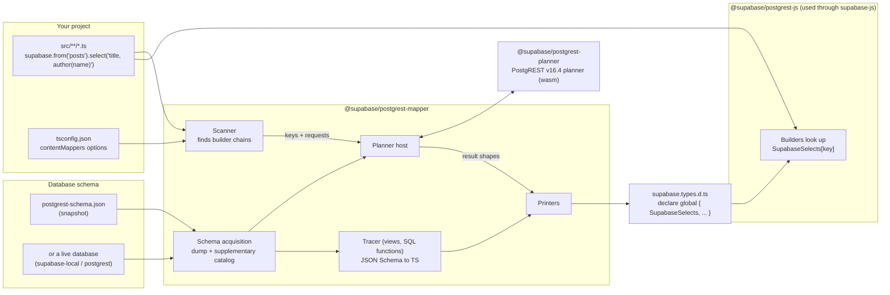
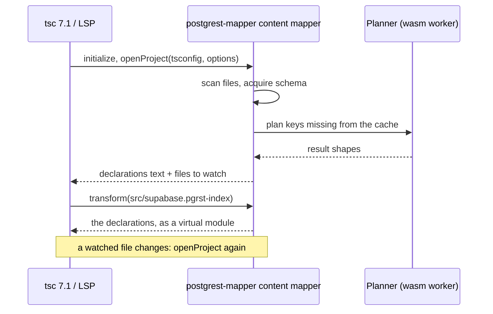

# How planner types work

This document explains how postgrest-js and supabase-js v3 type database queries. It is written for SDK maintainers. For a
hands-on tour, open the example project at
[`packages/core/supabase-js/example/planner-types`](../packages/core/supabase-js/example/planner-types/README.md) and hover the
queries.

## The idea in one sentence

TypeScript no longer parses select strings. A tool finds every query in the project, asks the **real PostgREST planner**
what each one returns, and writes the answers into a declaration file. The builders then look up their result type by key.

## Why change

In v2, the type of `select('id, author(name)')` came from a parser written in TypeScript's type system. It re-implemented
PostgREST's select grammar, embedding rules and nullability rules in types. It was:

- **Hard to maintain.** Every PostgREST feature (spreads, aggregates, JSON paths, computed fields, `!inner`, casts) had to be
  written a second time in type-level code.
- **Never quite right.** The type parser guessed: it could not see foreign key validity, view definitions, function bodies,
  JSON Schema CHECKs or overload resolution.
- **Slow.** Long select strings made the type checker work hard on every keystroke.

In v3 the answer comes from PostgREST itself. The planner (the code that turns a request into SQL) is compiled from upstream
PostgREST v16.4 to WebAssembly. Whatever PostgREST decides, the types say.

## Big picture



Four packages take part:

| Package                       | Role                                                                                                                   |
| ----------------------------- | ---------------------------------------------------------------------------------------------------------------------- |
| `@supabase/postgrest-planner` | The PostgREST planner compiled to wasm, with a small JS API: `load` a schema, `plan` a request.                        |
| `@supabase/postgrest-mapper`  | Everything else: scanner, schema acquisition, tracer, printers, the `postgrest-mapper` CLI, the TS 7.1 content mapper. |
| `@supabase/postgrest-js`      | The query builders. Their types read the generated globals; there is no select parser left.                            |
| `@supabase/supabase-js`       | `createClient()` with no type argument. It forwards to postgrest-js.                                                   |

The mapper is a library first. The CLI and the content mapper are thin wrappers around the same functions
(`generate`, `check`, `watch`, `refresh`, `snapshot`, `init`), so other tools, such as the Supabase CLI, can call them
directly.

## A query, step by step

Take this query from the example project:

```ts
const { data } = await supabase
  .from('posts')
  .select('title, author:authors!author_id(name), editor:authors!editor_id(name)')
```

The schema has `posts.author_id` and `posts.editor_id`, both `NOT NULL`. The `author_id` foreign key is validated. The
`editor_id` foreign key is `NOT VALID`, so Postgres does not promise that the editor row exists.

### 1. The scanner finds the chain

The scanner parses every source file with oxc-parser. It only looks at syntax and never type-checks. It finds
`from('posts').select('…')` and builds a **key**:

```
r|public|posts|title, author:authors!author_id(name), editor:authors!editor_id(name)
│ │      │     └─ the select string, exactly as written
│ │      └─ the relation
│ └─ the schema (from .schema('…') or the defaultSchema option)
└─ the kind: r = read, w = mutation followed by .select(), f = rpc
```

### 2. The planner answers

The mapper turns the key into the request postgrest-js would send:

```
GET /posts?select=title,author:authors!author_id(name),editor:authors!editor_id(name)
Accept-Profile: public
```

The planner returns a **result shape**: every output field with its type and nullability, every embed with its
cardinality and join type. In this case the planner says `author` is a to-one embed that is never null (validated FK on a
`NOT NULL` column), while `editor` may be null (the FK is `NOT VALID`).

### 3. The printer writes an entry

```ts
// src/supabase.types.d.ts (generated, abridged)
declare global {
  interface SupabaseSelects {
    'r|public|posts|title, author:authors!author_id(name), editor:authors!editor_id(name)': {
      row: {
        title: SupabaseColumnType<'public.posts.title', string>
        author: { name: SupabaseColumnType<'public.authors.name', string> }
        editor: { name: SupabaseColumnType<'public.authors.name', string> } | null
      }
      sources: { title: 'title' }
      embeds: {
        author: { path: ['author']; outputs: [['author']]; join: 'left'; cardinality: 'one' }
        editor: { path: ['editor']; outputs: [['editor']]; join: 'left'; cardinality: 'one' }
      }
    }
  }
}
```

- `row` is the result row.
- `SupabaseColumnType<'schema.table.column', T>` is `T` unless the user overrides that column (see
  [Overrides](#overrides)).
- `sources` and `embeds` describe where each field comes from. Filters use them to adjust the row (see
  [Filters](#filters-change-nullability)).

### 4. The builder looks it up

`from('posts')` records the kind, schema and relation in the builder's type state. `.select(q)` adds the select string.
The result type is then a plain indexed access:


What the editor shows on hover:

```ts
const data:
  | {
      title: string
      author: { name: string }
      editor: { name: string } | null
    }[]
  | null
```

There is no recursion over the string and no parsing, so the cost does not grow with the length of the select.

## The generated globals

Everything the builders need lives in global interfaces in one generated file. Global interfaces are why
`createClient()` takes no type argument.

| Global                | Content                                                                                                                                                                            |
| --------------------- | ---------------------------------------------------------------------------------------------------------------------------------------------------------------------------------- |
| `SupabaseDatabase`    | Per schema: `Tables` / `Views` (`Row`, `Insert`, `Update`), `Functions`, `Enums`. Used for `select('*')`, write payloads and plain-column filters.                                 |
| `SupabaseSelects`     | One entry per select key the project uses: reads, mutations with `.select()`, and rpc calls.                                                                                       |
| `SupabaseOperands`    | Filter targets that are not plain columns of the row: embedded columns (`author.name`), JSON paths, embeds tested with `is null`. Keyed by the select key followed by the operand. |
| `SupabasePgrstStatus` | `state`, the `unplanned` policy (`'loose'` or `'error'`) and feature flags.                                                                                                        |
| `SupabaseColumnTypes` | **User-owned.** Never generated. Overrides the type of a column by `schema.table.column`.                                                                                          |

A bare `select('*')` has no entry: the builder takes the `Row` from `SupabaseDatabase`.

## Two ways to deliver the declarations

Both use the same options, read from the `contentMappers` entry in `tsconfig.json`:

```jsonc
{
  "include": ["src"],
  "contentMappers": [
    {
      "package": "@supabase/postgrest-mapper",
      "extensions": [".pgrst-index"],
      "options": {
        "postgrest": "16.4",
        "defaultSchema": "public",
        "schema": { "source": "snapshot", "path": "postgrest-schema.json" },
      },
    },
  ],
}
```

`postgrest-mapper init` writes this entry, the `src/supabase.pgrst-index` stub and the `include` changes for you.

### A. Generated file (TypeScript 5.1 and later, Deno)

This is the path that works today in every editor.

```bash
postgrest-mapper generate --project tsconfig.json --out src/supabase.types.d.ts           # once
postgrest-mapper generate --project tsconfig.json --out src/supabase.types.d.ts --watch   # on every save
postgrest-mapper generate --project tsconfig.json --out src/supabase.types.d.ts --check   # CI: fail if stale
postgrest-mapper refresh --project tsconfig.json --out src/supabase.types.d.ts            # clear the cache, regenerate
```

```mermaid
sequenceDiagram
  actor Dev as Developer
  participant Editor as Editor (tsserver)
  participant Watch as postgrest-mapper --watch
  participant Planner as Planner (wasm worker)

  Dev->>Editor: types .select('title, excerpt') and saves
  Editor-->>Dev: hover: loose (key not generated yet)
  Watch->>Watch: file changed: scan, derive keys
  Watch->>Watch: cache lookup (node_modules/.cache/postgrest-mapper)
  Watch->>Planner: plan the new keys only
  Planner-->>Watch: result shapes
  Watch->>Editor: rewrites src/supabase.types.d.ts
  Editor-->>Dev: hover: { title: string; excerpt: string | null }[]
```

Plans are cached per schema, so a regeneration only plans keys it has not seen.

### B. TypeScript 7.1 content mapper (no generated file)

TypeScript 7.1 (typescript-go) can run a **content mapper**: a process that supplies the contents of files with a given
extension. The mapper package registers itself for `.pgrst-index`. When the compiler opens the stub
`src/supabase.pgrst-index`, it asks the mapper for its contents, and the mapper answers with the same declarations,
in memory.



This runs external code, so the compiler requires opt-in: `tsc --runExternalCode`, or
`initializationOptions.runExternalCode` for the language server. The command line and the 7.1 language server work in the
example project. Editor extension support is still being verified, so path A is the default for now.

## Where the schema comes from

The planner needs the same inputs PostgREST loads at startup, plus facts PostgREST's schema dump does not keep.

| `schema.source`  | How                                                                                                        |
| ---------------- | ---------------------------------------------------------------------------------------------------------- |
| `snapshot`       | A committed `postgrest-schema.json`. No Docker, no network: CI and fresh clones just work.                 |
| `supabase-local` | The running `supabase start` stack: PostgREST's own `--dump-schema` and `--dump-config`, plus SQL queries. |
| `postgrest`      | A pinned PostgREST image run with `docker run` against a database URL.                                     |

`postgrest-mapper snapshot` writes a snapshot from a live source.

Each acquisition has three parts:

1. **The PostgREST schema dump and config**: exactly what PostgREST itself uses to plan.
2. **The supplementary catalog**: read-only SQL for what the dump lacks. That includes column order, foreign key validity
   (`convalidated`), function return and `OUT` types, view definitions, SQL function bodies, JSON Schema CHECK constraints,
   enums, casts, and aggregate overloads.
3. **Versions**: the mapper refuses a schema from another PostgREST `major.minor` line than the planner's, because the
   planner's answers would not describe that server.

## What the mapper adds on top of the planner

The planner decides structure: which embeds exist, their cardinality and join type, field names, spreads, aggregates and
casts. The mapper adds facts the planner does not track.

**View and SQL function tracer.** Postgres reports every view column and every function result column as nullable. The
tracer reads view definitions and `LANGUAGE sql` function bodies and follows each column back to its table:

```sql
create view post_summaries as
  select p.title, a.name as author_name, e.name as editor_name
  from posts p
  join authors a on a.id = p.author_id       -- inner join: keeps NOT NULL
  left join authors e on e.id = p.editor_id; -- left join: nullable
```

```ts
// select('title, author_name, editor_name') on the view
{
  title: string
  author_name: string
  editor_name: string | null
}
;[]
```

A function body it cannot trace keeps every column nullable, which is what Postgres promises.

**JSON Schema CHECKs.** A validated `CHECK (jsonb_matches_schema('{…}', metadata))` (pg_jsonschema) becomes the column's
TypeScript type. JSON paths into it are typed too:

```ts
.select('title, metadata, seo_title:metadata->seo->>title, tags:metadata->tags')
// metadata:  { tags: string[]; featured?: boolean; theme?: 'light' | 'dark'; seo?: {…} } | null
// seo_title: string | null
// tags:      string[] | null
```

## Filters change nullability

Filters do not change the planned entry, but they can change what the response may contain. The builder applies those
changes to the row type, using `embeds` and `SupabaseOperands`.

```ts
// author is non-null in a plain select (validated FK)
supabase.from('posts').select('title, author:authors!author_id(name)')
// → { title: string; author: { name: string } }[]

// a filter on a left-joined embed can null it out: PostgREST keeps the post, with author: null
supabase
  .from('posts')
  .select('title, author:authors!author_id(name)')
  .eq('author.name', 'Ada Lovelace')
// → { title: string; author: { name: string } | null }[]

// testing the embed itself narrows it back
supabase.from('posts').select('title, editor:authors!editor_id(name)').not('editor', 'is', null)
// → { title: string; editor: { name: string } }[]
```

Filter values are checked against the column type:

```ts
supabase.from('posts').select('title').eq('status', 'published') // ok: an enum label
supabase.from('posts').select('title').eq('status', 'announced') // error: not a post_status
supabase.from('posts').select('title').eq('views', 'many') // error: views is an integer
```

## RPC

An rpc entry has one `calls` element per set of argument keys and HTTP method the project actually uses. The builder
picks the call by the **keys** of the argument object, just like PostgREST picks an overload:

```ts
// find_posts(term text) returns setof posts
// find_posts(author_id bigint, status post_status) returns table(id, title, views)
await supabase.rpc('find_posts', { term: 'compiler' }) // posts rows
await supabase.rpc('find_posts', { author_id: 1, status: 'published' }) // { id, title, views } rows
await supabase.rpc('find_posts', { author_id: 'one' }) // error: bigint expected
```

A function returning rows accepts `.select()`, embeds and filters, like a table. With `{ get: true }`, arguments travel in
the query string. An argument the query string cannot carry, such as an object for a `jsonb` parameter, is rejected at
compile time with `PGRSTJS01`.

## Writes

`Insert` requires exactly the columns that are `NOT NULL` with no default. It leaves out identity and generated
columns. `Update` makes every column optional. A `.select()` after a write is planned like a read, under a `w|` key:

```ts
const { data } = await supabase
  .from('posts')
  .insert({ author_id: 1, editor_id: 2, title: 'Hello', slug: 'hello' })
  .select('id, title, status')
  .single()
// data: { id: number; title: string; status: 'draft' | 'published' | 'archived' } | null
```

`.single()`, `.maybeSingle()`, `{ count: 'exact', head: true }`, `.csv()` and `.throwOnError()` reshape the response
around the planned row as before.

## When there is no plan

A chain is **unplanned** when the generated file has no entry for its key. That happens when:

- the select string is not a literal (`select(columns.join(','))`). No tool can know it before the program runs.
- the code is new and `generate` has not run yet. `--watch` closes this gap within a moment of saving.

Unplanned chains follow the `unplanned` option:

- `'loose'` (default): rows are loosely typed (`unknown` / `Record<string, unknown>`), and the code still compiles.
- `'error'`: an unplanned chain is a type error. Use this in CI together with `generate --check`.

A select the planner **rejects** (an unknown column, an ambiguous relationship) gets an `{ error }` entry. The builder
shows the PostgREST error message, for example `PGRST200: Could not find a relationship …`, as a type error at the call.

## Overrides

**`SupabaseColumnTypes`** sets the type of a column the database does not describe, such as a plain `jsonb` column or an
array that may hold nulls. It applies everywhere the column appears: selects, filters and write payloads. The column's
own nullability is kept.

```ts
declare global {
  interface SupabaseColumnTypes {
    'public.authors.socials': { github?: string; mastodon?: string }
  }
}
// select('name, socials') → { name: string; socials: { github?: string; mastodon?: string } | null }[]
```

**`.cast<T>()`** replaces the row type of one call and keeps the response shape (array, single row, count). It replaces
v2's `.returns<T>()` and `.overrideTypes<T>()`.

```ts
const { data } = await supabase
  .from('posts')
  .select('id, title')
  .cast<{ id: number; title: string; note?: string }>()
```

## Known limits

- **Arrays** are typed as one-dimensional with non-null elements (`int4[]` is `number[]`). Postgres enforces neither
  property; use `SupabaseColumnTypes` when a column holds null elements or nested arrays.
- **Aggregates** assume Postgres' builtin `count`, `sum`, `avg`, `min` and `max`. A user function of the same name that
  Postgres would pick instead is only detected in the common cases.
- **Dynamic select strings** are always unplanned (see above).
- **Untraceable function bodies** (anything but a single-query `LANGUAGE sql` function, or a `search_path` with `$user`)
  keep their result columns nullable.

The package READMEs list the precise limits:
[postgrest-mapper](../packages/tooling/postgrest-mapper/README.md),
[postgrest-planner](../packages/tooling/postgrest-planner/README.md) and
[postgrest-js](../packages/core/postgrest-js/README.md#typing).

## Where to look in the code

| Concern                         | Location                                                      |
| ------------------------------- | ------------------------------------------------------------- |
| Planner wasm and JS API         | `packages/tooling/postgrest-planner/`                         |
| Scanner and key derivation      | `packages/tooling/postgrest-mapper/src/scanner.ts`, `keys.ts` |
| Schema acquisition and snapshot | `packages/tooling/postgrest-mapper/src/schema/`               |
| Planner host (worker, timeouts) | `packages/tooling/postgrest-mapper/src/host/`                 |
| View and function tracer        | `packages/tooling/postgrest-mapper/src/tracer/`               |
| JSON Schema to TypeScript       | `packages/tooling/postgrest-mapper/src/jsonschema/`           |
| Generator, cache and printers   | `packages/tooling/postgrest-mapper/src/generate/`, `printer/` |
| CLI and library operations      | `packages/tooling/postgrest-mapper/src/cli/`, `operations/`   |
| TS 7.1 content mapper           | `packages/tooling/postgrest-mapper/src/content-mapper/`       |
| Builder lookup and filter facts | `packages/core/postgrest-js/src/types/planner/`               |
| End-to-end example              | `packages/core/supabase-js/example/planner-types/`            |
