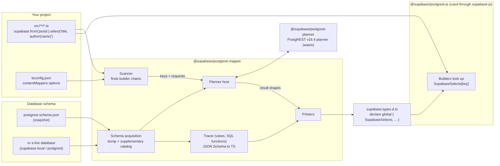
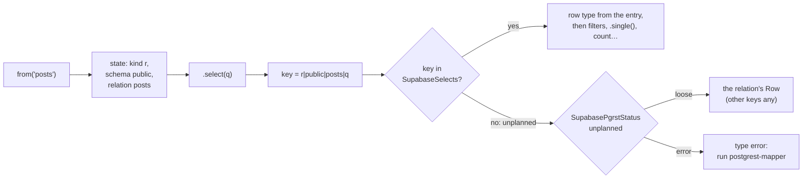
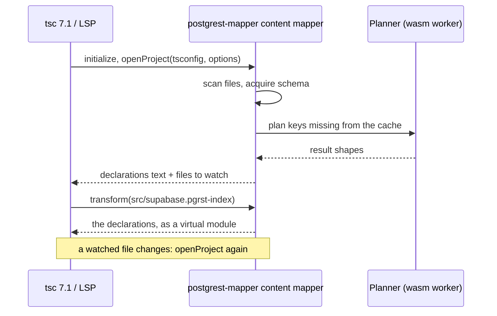
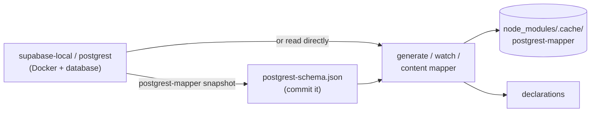

# How planner types work

This document explains how postgrest-js and supabase-js v3 type database queries. It is written for SDK maintainers. For a
hands-on tour, open the example project at
[`packages/core/supabase-js/example/planner-types`](../packages/core/supabase-js/example/planner-types/README.md) and hover the
queries.

## The idea in one sentence

TypeScript no longer parses select strings. A tool finds every query in the project, asks the **real PostgREST planner**
what each one returns, and writes the answers into a declaration file. The builders then look up their result type by key.

## Why change

In v2, the type of `select('id, author(name)')` came from a parser written in TypeScript's type system. It re-implemented
PostgREST's select grammar, embedding rules and nullability rules in types. It was:

- **Hard to maintain.** Every PostgREST feature (spreads, aggregates, JSON paths, computed fields, `!inner`, casts) had to be
  written a second time in type-level code.
- **Never quite right.** The type parser guessed from the generated `Database` type. It could not see foreign key
  validity, view definitions, function bodies or JSON Schema CHECKs, and filters never changed the result type.
- **Costly to type-check.** Every select string was parsed again by the type checker, character by character, and large
  schemas hit instantiation depth limits.

In v3 the answer comes from PostgREST itself. The planner (the code that turns a request into SQL) is compiled from upstream
PostgREST v16.4 to WebAssembly. Whatever PostgREST decides, the types say.

[Compared with v2](#compared-with-v2) sums up what this gains and costs: features, type-check performance and the day-to-day
workflow.

## Big picture



Four packages take part:

| Package                       | Role                                                                                                                       |
| ----------------------------- | -------------------------------------------------------------------------------------------------------------------------- |
| `@supabase/postgrest-planner` | The PostgREST planner compiled to wasm, with a small JS API: `load` a schema, `plan` a request.                            |
| `@supabase/postgrest-mapper`  | Everything else: scanner, schema acquisition, tracer, printers, the `postgrest-mapper` CLI, the TS 7.1 content mapper.     |
| `@supabase/postgrest-js`      | The query builders. Their types read the generated globals; there is no select parser left.                                |
| `@supabase/supabase-js`       | `createClient()`, with no type argument needed (v2's `createClient<Database>()` still works). It forwards to postgrest-js. |

The mapper is a library first. The CLI and the content mapper are thin wrappers around the same functions
(`generate`, `check`, `watch`, `refresh`, `snapshot`, `init`), so other tools, such as the Supabase CLI, can call them
directly.

## A query, step by step

Take this query from the example project:

```ts
const { data } = await supabase
  .from('posts')
  .select('title, author:authors!author_id(name), editor:authors!editor_id(name)')
```

The schema has `posts.author_id` and `posts.editor_id`, both `NOT NULL`. The `author_id` foreign key is validated. The
`editor_id` foreign key is `NOT VALID`, so Postgres does not promise that the editor row exists.

### 1. The scanner finds the chain

The scanner parses every source file with oxc-parser. It only looks at syntax and never type-checks. It finds
`from('posts').select('…')` and builds a **key**:

```
r|public|posts|title, author:authors!author_id(name), editor:authors!editor_id(name)
│ │      │     └─ the select string, exactly as written
│ │      └─ the relation
│ └─ the schema (from .schema('…') or the defaultSchema option)
└─ the kind: r = read, w = mutation followed by .select(), f = rpc
```

### 2. The planner answers

The mapper turns the key into the request postgrest-js would send:

```
GET /posts?select=title,author:authors!author_id(name),editor:authors!editor_id(name)
Accept-Profile: public
```

The planner returns a **result shape**: every output field with its type and nullability, every embed with its
cardinality and join type. In this case the planner says `author` is a to-one embed that is never null (validated FK on a
`NOT NULL` column), while `editor` may be null (the FK is `NOT VALID`).

### 3. The printer writes an entry

```ts
// src/supabase.types.d.ts (generated, abridged)
declare global {
  interface SupabaseSelects {
    'r|public|posts|title, author:authors!author_id(name), editor:authors!editor_id(name)': {
      row: {
        title: SupabaseColumnType<'public.posts.title', string>
        author: { name: SupabaseColumnType<'public.authors.name', string> }
        editor: { name: SupabaseColumnType<'public.authors.name', string> } | null
      }
      sources: { title: 'title' }
      embeds: {
        author: { path: ['author']; outputs: [['author']]; join: 'left'; cardinality: 'one' }
        editor: { path: ['editor']; outputs: [['editor']]; join: 'left'; cardinality: 'one' }
      }
    }
  }
}
```

- `row` is the result row.
- `SupabaseColumnType<'schema.table.column', T>` is `T` unless the user overrides that column (see
  [Overrides](#overrides)).
- `sources` and `embeds` describe where each field comes from. Filters use them to adjust the row (see
  [Filters](#filters-change-nullability)).

### 4. The builder looks it up

`from('posts')` records the kind, schema and relation in the builder's type state. `.select(q)` adds the select string.
The result type is then a plain indexed access:



What the editor shows on hover:

```ts
const data:
  | {
      title: string
      author: { name: string }
      editor: { name: string } | null
    }[]
  | null
```

There is no recursion over the string and no parsing, so the cost does not grow with the length of the select.

## The generated globals

Everything the builders need lives in global interfaces in one generated file. Global interfaces are why
`createClient()` needs no type argument.

| Global                | Content                                                                                                                                                                            |
| --------------------- | ---------------------------------------------------------------------------------------------------------------------------------------------------------------------------------- |
| `SupabaseDatabase`    | Per schema: `Tables` / `Views` (`Row`, `Insert`, `Update`), `Functions`, `Enums`. Used for `select('*')`, write payloads and plain-column filters.                                 |
| `SupabaseSelects`     | One entry per select key the project uses: reads, mutations with `.select()`, and rpc calls.                                                                                       |
| `SupabaseOperands`    | Filter targets that are not plain columns of the row: embedded columns (`author.name`), JSON paths, embeds tested with `is null`. Keyed by the select key followed by the operand. |
| `SupabasePgrstStatus` | `state`, the `unplanned` policy (`'loose'` or `'error'`) and feature flags.                                                                                                        |
| `SupabaseColumnTypes` | **User-owned.** Never generated. Overrides the type of a column by `schema.table.column`.                                                                                          |

A bare `select('*')` has no entry: the builder takes the `Row` from `SupabaseDatabase`.

## Two ways to deliver the declarations

Both use the same options, read from the `contentMappers` entry in `tsconfig.json`:

```jsonc
{
  "include": ["src"],
  "contentMappers": [
    {
      "package": "@supabase/postgrest-mapper",
      "extensions": [".pgrst-index"],
      "options": {
        "postgrest": "16.4",
        "defaultSchema": "public",
        "schema": { "source": "snapshot", "path": "postgrest-schema.json" },
      },
    },
  ],
}
```

`postgrest-mapper init` sets up a project in one command. It writes this entry, saves a schema snapshot from the running
local stack, and picks one producer of the declarations from the TypeScript the project resolves: the content mapper on
7.1 and later (it adds the `src/supabase.pgrst-index` stub to `include`), otherwise a generated file, which it writes
once. It also adds `postgrest:watch`, `postgrest:check` and `postgrest:snapshot` package scripts (only `postgrest:snapshot`
for the content mapper). A step that cannot run, for example because the stack is down, is reported as skipped.

### A. Generated file (TypeScript 5.1 and later, Deno)

This is the path that works today in every editor.

```bash
postgrest-mapper generate --project tsconfig.json --out src/supabase.types.d.ts           # once
postgrest-mapper generate --project tsconfig.json --out src/supabase.types.d.ts --watch   # on every save
postgrest-mapper generate --project tsconfig.json --out src/supabase.types.d.ts --check   # CI: fail if stale
postgrest-mapper refresh --project tsconfig.json --out src/supabase.types.d.ts            # clear the cache, regenerate
```

```mermaid
sequenceDiagram
  actor Dev as Developer
  participant Editor as Editor (tsserver)
  participant Watch as postgrest-mapper --watch
  participant Planner as Planner (wasm worker)

  Dev->>Editor: types .select('title, excerpt') and saves
  Editor-->>Dev: hover: the table Row (key not generated yet)
  Watch->>Watch: file changed: scan, derive keys
  Watch->>Watch: cache lookup (node_modules/.cache/postgrest-mapper)
  Watch->>Planner: plan the new keys only
  Planner-->>Watch: result shapes
  Watch->>Editor: rewrites src/supabase.types.d.ts
  Editor-->>Dev: hover: { title: string; excerpt: string | null }[]
```

Plans are cached per schema, so a regeneration only plans keys it has not seen (see
[Caching](#caching-offline-use-and-freshness)).

### B. TypeScript 7.1 content mapper (no generated file)

TypeScript 7.1 (typescript-go) can run a **content mapper**: a process that supplies the contents of files with a given
extension. The mapper package registers itself for `.pgrst-index`. When the compiler opens the stub
`src/supabase.pgrst-index`, it asks the mapper for its contents, and the mapper answers with the same declarations,
in memory.



This runs external code, so the compiler requires opt-in: `tsc --runExternalCode`, or
`initializationOptions.runExternalCode` for the language server. The command line and the 7.1 language server work in the
example project. Editor extension support is still being verified, so path A is the default for now.

#### Why an index file?

A content mapper can only supply the contents of a file that is already in the program. The compiler finds files
through `include`, and asks the mapper for the TypeScript of each file whose extension is registered. It has no hook for
adding a module out of nothing. Our declarations do not belong to any one source file: they are globals built from every
query in the project. So the project needs one placeholder file whose only job is to be included with the registered
extension. Its content is ignored.

- **Its own extension**, so that only this file triggers the mapper. TypeScript 5.x and Deno (path A) skip it because
  `.pgrst-index` is not a TypeScript extension. The CLI reads only the options of the `contentMappers` entry.
- **One per project**, because the globals must be declared exactly once. Any other `.pgrst-index` file gets diagnostic
  2001 and an empty module.
- **Where errors show up**: the compiler reports problems in the generated declarations at the top of this file.

## Where the schema comes from

The planner needs the same inputs PostgREST loads at startup, plus facts PostgREST's schema dump does not keep. The
`schema` option says where to read them:

| `schema.source`  | What runs                                                                                                                             | Needs                                        |
| ---------------- | ------------------------------------------------------------------------------------------------------------------------------------- | -------------------------------------------- |
| `snapshot`       | Reads a committed `postgrest-schema.json`.                                                                                            | Nothing: no Docker, no database, no network. |
| `supabase-local` | `supabase status` finds the local stack. `docker exec` runs `postgrest --dump-schema` and `--dump-config` in its PostgREST container. | `supabase start` running, Docker.            |
| `postgrest`      | `docker run` of the pinned `supabase/postgrest:v16.4` image with `--dump-schema` against the database URL in `schema.dbUrlEnv`.       | Docker, a reachable database.                |

Each acquisition has three parts:

1. **The PostgREST schema dump and config**: exactly what PostgREST itself uses to plan. The config is stored without
   `db-uri`.
2. **The supplementary catalog**: read-only SQL for what the dump lacks. That includes column order, foreign key validity
   (`convalidated`), function return and `OUT` types, view definitions, SQL function bodies, JSON Schema CHECK constraints,
   enums, casts, and aggregate overloads. It runs in a `READ ONLY` transaction that is rolled back.
3. **Versions**: the PostgREST release and the Postgres version. The mapper refuses a schema from another PostgREST
   `major.minor` line than the planner's (diagnostic 2006), because the planner's answers would not describe that server.
   A different patch release is only a warning.



### Caching, offline use and freshness

**Offline.** `postgrest-mapper snapshot` reads a live source once and writes everything above into one JSON file. With
`schema.source: "snapshot"`, generating needs no Docker, no database and no network: the planner and the tracer are wasm
inside the npm packages. This is the recommended setup for CI and for teammates who only change queries. The example
project works this way.

**What is cached.**

- **Plans.** Each result shape is cached on disk in `node_modules/.cache/postgrest-mapper/`, in one file per schema. The
  file name comes from a hash of the whole acquired schema. An entry is reused only when the schema hash, the planner
  build and the generator version all match. Change the schema and every key is planned again. Add a query and only
  that key is planned.
- **The schema itself is not cached on disk.** Every run reads it first, even when every plan is in the cache. With a
  snapshot that is a file read. With a live source, Docker and the database must be up. A long-running process (`--watch`,
  the content mapper) reads a live schema once and keeps it in memory. It also keeps the planner loaded with that schema,
  so a regeneration only plans the new keys.
- `postgrest-mapper refresh` clears the cache and reads the schema again. It is rarely needed: use it to force a reload,
  when polling is turned off, or in a one-shot run.

**When the database changes.** With a live source, `--watch` and the content mapper check the database for schema
changes every 2 seconds (`pollIntervalMs` on the source, `0` or `false` to turn it off). The check is one read-only
query over a connection they keep open. It hashes the catalog rows PostgREST's schema cache is built from, so `CREATE`,
`ALTER`, `DROP` and `GRANT` change the hash while `ANALYZE`, `VACUUM`, `TRUNCATE` and `REFRESH MATERIALIZED VIEW` don't.
The baseline hash is taken just before the schema is read, so a migration that lands during the read is still seen. If
that baseline can't be taken, the first check that succeeds counts as a change. No check runs while a regeneration is in
progress. When the hash moves, the poller writes it to a stamp file in the cache directory. The watcher sees the stamp
change and reads the schema again, and so does the content mapper, which asks `tsc` to watch the same stamp. A migration
therefore regenerates the types within a couple of seconds, with no command to run. The hash covers the whole database,
so DDL in a schema PostgREST doesn't expose also triggers a regeneration, which re-reads the schema but leaves the
output unchanged. A failed check keeps the last state, warns once and is retried at the next interval. One-shot commands
(`generate`, `--check`, `snapshot`, `refresh`) never poll.

With a snapshot, nothing polls: run `postgrest-mapper snapshot` again after a migration and commit the file. The watcher
sees the new file and regenerates.

## What the mapper adds on top of the planner

The planner decides structure: which embeds exist, their cardinality and join type, field names, spreads, aggregates and
casts. The mapper adds facts the planner does not track.

**View and SQL function tracer.** Postgres reports every view column and every function result column as nullable. The
tracer reads view definitions and `LANGUAGE sql` function bodies and follows each column back to its table:

```sql
create view post_summaries as
  select p.title, a.name as author_name, e.name as editor_name
  from posts p
  join authors a on a.id = p.author_id       -- inner join: keeps NOT NULL
  left join authors e on e.id = p.editor_id; -- left join: nullable
```

```ts
// select('title, author_name, editor_name') on the view
{
  title: string
  author_name: string
  editor_name: string | null
}
;[]
```

A function body it cannot trace keeps every column nullable, which is what Postgres promises.

**JSON Schema CHECKs.** A validated `CHECK (jsonb_matches_schema('{…}', metadata))` (pg_jsonschema) becomes the column's
TypeScript type. JSON paths into it are typed too:

```ts
.select('title, metadata, seo_title:metadata->seo->>title, tags:metadata->tags')
// metadata:  { tags: string[]; featured?: boolean; theme?: 'light' | 'dark'; seo?: {…} } | null
// seo_title: string | null
// tags:      string[] | null
```

## Filters change nullability

Filters do not change the planned entry, but they can change what the response may contain. The builder applies those
changes to the row type, using `embeds` and `SupabaseOperands`.

```ts
// author is non-null in a plain select (validated FK)
supabase.from('posts').select('title, author:authors!author_id(name)')
// → { title: string; author: { name: string } }[]

// a filter on a left-joined embed can null it out: PostgREST keeps the post, with author: null
supabase
  .from('posts')
  .select('title, author:authors!author_id(name)')
  .eq('author.name', 'Ada Lovelace')
// → { title: string; author: { name: string } | null }[]

// testing the embed itself narrows it back
supabase.from('posts').select('title, editor:authors!editor_id(name)').not('editor', 'is', null)
// → { title: string; editor: { name: string } }[]
```

Filter values are checked against the column type:

```ts
supabase.from('posts').select('title').eq('status', 'published') // ok: an enum label
supabase.from('posts').select('title').eq('status', 'announced') // error: not a post_status
supabase.from('posts').select('title').eq('views', 'many') // error: views is an integer
```

## RPC

An rpc entry has one `calls` element per set of argument keys and HTTP method the project actually uses. The builder
picks the call by the **keys** of the argument object, just like PostgREST picks an overload:

```ts
// find_posts(term text) returns setof posts
// find_posts(author_id bigint, status post_status) returns table(id, title, views)
await supabase.rpc('find_posts', { term: 'compiler' }) // posts rows
await supabase.rpc('find_posts', { author_id: 1, status: 'published' }) // { id, title, views } rows
await supabase.rpc('find_posts', { author_id: 'one' }) // error: bigint expected
```

A function returning rows accepts `.select()`, embeds and filters, like a table. With `{ get: true }`, arguments travel in
the query string. An argument the query string cannot carry, such as an object for a `jsonb` parameter, is a type error
that names the key. At runtime the same call returns the error `PGRSTJS01` instead of sending the request.

## Writes

`Insert` requires exactly the columns that are `NOT NULL` with no default. It leaves out identity and generated
columns. `Update` makes every column optional. A `.select()` after a write is planned like a read, under a `w|` key:

```ts
const { data } = await supabase
  .from('posts')
  .insert({ author_id: 1, editor_id: 2, title: 'Hello', slug: 'hello' })
  .select('id, title, status')
  .single()
// data: { id: number; title: string; status: 'draft' | 'published' | 'archived' } | null
```

`.single()`, `.maybeSingle()`, `{ count: 'exact', head: true }`, `.csv()` and `.throwOnError()` reshape the response
around the planned row as before. v2's explicit type argument on `insert`, `upsert` and `update`
(`.insert<Row>(values)`) is still accepted: the type must fit the table's `Insert` or `Update`, and the values are
checked against it.

## When there is no plan

A chain is **unplanned** when the generated file has no entry for its key. That happens when:

- the select string is not a literal (`select(columns.join(','))`). No tool can know it before the program runs.
- the code is new and `generate` has not run yet. `--watch` closes this gap within a moment of saving.

Unplanned chains follow the `unplanned` option:

- `'loose'` (default): rows come from the relation's `Row` in the client's `Database` (the generated `SupabaseDatabase`,
  or a v2 `Database` passed as `createClient<Database>()`). Its columns keep their types and any other key is `any`,
  because the select may alias or embed. An unplanned rpc gets the function's `Returns`. With no `Database` the rows are
  `Record<string, unknown>`. The code still compiles either way.
- `'error'`: an unplanned chain is a type error, and the fallback is off. Use this in CI together with
  `generate --check`.

A select the planner **rejects** (an unknown column, an ambiguous relationship) gets an `{ error }` entry. The builder
shows the PostgREST error message, for example `PGRST200: Could not find a relationship …`, as a type error at the call.

## Overrides

**`SupabaseColumnTypes`** sets the type of a column the database does not describe, such as a plain `jsonb` column or an
array that may hold nulls. It applies everywhere the column appears: selects, filters and write payloads. The column's
own nullability is kept.

```ts
declare global {
  interface SupabaseColumnTypes {
    'public.authors.socials': { github?: string; mastodon?: string }
  }
}
// select('name, socials') → { name: string; socials: { github?: string; mastodon?: string } | null }[]
```

**`.cast<T>()`** replaces the row type of one call and keeps the response shape (array, single row, count). v2's
`.returns<T>()` and `.overrideTypes<T>()` still work with their v2 meaning, applied on top of the planned result, and
are deprecated in favour of `.cast<T>()` and `SupabaseColumnTypes`. So is v2's type argument on `.single<T>()` and
`.maybeSingle<T>()`, which now means `.cast<T>().single()`.

```ts
const { data } = await supabase
  .from('posts')
  .select('id, title')
  .cast<{ id: number; title: string; note?: string }>()
```

## Compared with v2

### What v3 types that v2 did not

Both versions type embeds, aliases, `!inner`, foreign key hints, spreads, aggregates, casts, JSON paths, computed fields,
rpc overloads and filter values. The difference is in how right the answer is, and in what the type parser could not
know:

| Case                                                    | v2 (type-level parser)                                                            | v3 (planner)                                                                          |
| ------------------------------------------------------- | --------------------------------------------------------------------------------- | ------------------------------------------------------------------------------------- |
| To-one embed through a `NOT VALID` foreign key          | Non-null when the FK column is `NOT NULL`, though the row may not exist           | Nullable: the FK is not validated                                                     |
| View columns                                            | Whatever the generated `Database` type says                                       | Traced to the base table: `NOT NULL` through inner joins, nullable through left joins |
| `LANGUAGE sql` function results                         | Whatever the generated `Database` type says                                       | Traced like a view                                                                    |
| `jsonb` column with a JSON Schema CHECK (pg_jsonschema) | `Json`                                                                            | The TypeScript type of the schema, and JSON paths into it                             |
| `sum`, `avg`, `min`, `max`                              | `number`                                                                          | `number \| null`: they are null on an empty set                                       |
| A filter on an embedded column, `.eq('author.name', …)` | Result type unchanged, so `author` stays non-null though PostgREST returns `null` | `author` becomes nullable                                                             |
| `.not('editor', 'is', null)` on an embed                | Root columns only                                                                 | Narrows the embed to non-null                                                         |
| rpc `{ get: true }` with an object argument             | Not checked                                                                       | Type error naming the key                                                             |
| Unknown column or relationship                          | A parser error type                                                               | PostgREST's own error, e.g. `PGRST200: Could not find a relationship …`               |
| Select string that is not a literal                     | Error type                                                                        | The relation's `Row`, other keys `any`; an error with `unplanned: 'error'`            |
| Column type the database does not describe              | `.returns<T>()` / `.overrideTypes<T>()` per call                                  | `SupabaseColumnTypes` once per column, or `.cast<T>()` per call                       |

More generally, any PostgREST behaviour the parser did not reimplement was wrong or missing in v2. In v3 it is right by
construction, and a new PostgREST release is a rebuild of the wasm, not new type-level code.

### Upgrading

v2 code compiles on v3 in the common case. Until the declarations are generated, chains are typed from the v2 `Database`
passed to `createClient<Database>()` (see [When there is no plan](#when-there-is-no-plan)). `.returns<T>()`,
`.overrideTypes<T>()`, `.single<T>()`, `.maybeSingle<T>()`, the `foreignTable` option, v2's `createClient` type
arguments and the `DatabaseWithoutInternals` type are kept as deprecated forms, and the explicit row type on writes is
still accepted. The [migration guide](../packages/core/postgrest-js/migrations/v3-planner-types.md) lists the steps
(`postgrest-mapper init`, then `unplanned: 'error'`) and the few remaining breaking changes.

### Performance

The same queries were type-checked with each version: 500 chains over the example project's schema (selects with embeds,
aliases, casts, spreads and `!inner`, filters, writes, rpc calls, and some long nested selects). v2 is
`@supabase/supabase-js` 2.118.0 with a `Database` type from postgres-meta, the generator behind `supabase gen types`. v3
is this branch with the generated file. Both compile with zero errors. Results are the median of 7 runs of
`tsc --noEmit --extendedDiagnostics` on an Apple M3, measured on 2026-10-26. Other work was running on the machine, so
the ratios are more reliable than the absolute times.

| TypeScript | v2 check time | v3 check time | v2 instantiations | v3 instantiations | v2 peak memory | v3 peak memory |
| ---------- | ------------- | ------------- | ----------------- | ----------------- | -------------- | -------------- |
| 5.8        | 6.44 s        | 0.58 s        | 14.6 M            | 480 k             | 900 MB         | 385 MB         |
| 6.0        | 4.19 s        | 0.60 s        | 5.5 M             | 386 k             | 1229 MB        | 384 MB         |
| 7.0        | 0.90 s        | 0.10 s        | 5.8 M             | 437 k             | 691 MB         | 184 MB         |
| 7.1 beta   | 0.73 s        | 0.09 s        | 5.7 M             | 437 k             | 476 MB         | 141 MB         |

- **7 to 11 times faster** to check, with 13 to 30 times fewer type instantiations, on every TypeScript version.
- **Each extra query** costs about 13 ms in v2 and 1 ms in v3 (TypeScript 5.8). In v3 the cost does not depend on the
  length of the select string.
- **Hover in the editor** (TypeScript 5.8 language service, a long select in a 200-query project): 148 ms in v2 and 5 ms
  in v3 once warm, 209 ms and 31 ms right after an edit.
- **Generating the types** with the mapper, from a snapshot: 0.77 s for 500 queries from an empty cache, 0.20 s after
  editing one select. The generated file is 365 KB.

The schema is small (three tables and a view). v2's cost also grows with the size of the `Database` type, which v3's
lookup does not depend on, so on a real project the gap is likely wider. 412 of the 500 result types are identical in both
versions. The other 88 differ because v3 is more precise (the `NOT VALID` foreign key, view columns, filters, write
responses).

#### Full results

**Method.** A generator writes deterministic query files (seed 20261024, 25 chains per file) at 1, 50, 200 and 500
chains. The 500-chain corpus holds 132 selects with embeds, 126 flat selects, 74 writes, 58 filtered selects, 30 filtered
`.single()` or `.maybeSingle()` calls, 71 rpc calls and 9 long nested selects, for 462 distinct select strings. Each
configuration runs `tsc --noEmit --extendedDiagnostics` under `/usr/bin/time -l`. All configurations run round-robin, so
machine drift hits them alike, after one discarded warm-up. Each number is the median of 7 runs. The machine is an Apple
M3 (8 cores, 24 GB) on Node 24.22.1, with a load average between 8 and 18 during the run. TypeScript versions are 5.8.3,
6.0.3, 7.0.2 and 7.1.0-beta. v3 uses the generated file unless a row says otherwise.

Check time is the compiler's own `Check time`. Instantiations are `Instantiations`. Peak memory is the process's peak
resident set size. The ratio columns are v2 divided by v3.

TypeScript 5.8.3:

| Chains | v2 check | v3 check | Ratio | v2 instantiations | v3 instantiations | Ratio | v2 peak memory | v3 peak memory |
| ------ | -------- | -------- | ----- | ----------------- | ----------------- | ----- | -------------- | -------------- |
| 1      | 0.09 s   | 0.03 s   | 3.0x  | 25 k              | 3 k               | 10.0x | 215 MB         | 176 MB         |
| 50     | 0.56 s   | 0.15 s   | 3.7x  | 946 k             | 62 k              | 15.3x | 329 MB         | 251 MB         |
| 200    | 2.72 s   | 0.31 s   | 8.8x  | 5.67 M            | 204 k             | 27.9x | 544 MB         | 316 MB         |
| 500    | 6.44 s   | 0.58 s   | 11.1x | 14.58 M           | 480 k             | 30.4x | 900 MB         | 385 MB         |

TypeScript 6.0.3:

| Chains | v2 check | v3 check | Ratio | v2 instantiations | v3 instantiations | Ratio | v2 peak memory | v3 peak memory |
| ------ | -------- | -------- | ----- | ----------------- | ----------------- | ----- | -------------- | -------------- |
| 1      | 0.07 s   | 0.04 s   | 1.8x  | 14 k              | 2 k               | 6.6x  | 187 MB         | 180 MB         |
| 50     | 0.44 s   | 0.15 s   | 2.9x  | 430 k             | 51 k              | 8.5x  | 326 MB         | 251 MB         |
| 200    | 1.75 s   | 0.31 s   | 5.6x  | 2.23 M            | 164 k             | 13.5x | 603 MB         | 318 MB         |
| 500    | 4.19 s   | 0.60 s   | 7.0x  | 5.46 M            | 386 k             | 14.1x | 1229 MB        | 384 MB         |

TypeScript 7.0.2 (checks on several threads by default):

| Chains | v2 check | v3 check | Ratio | v2 instantiations | v3 instantiations | Ratio | v2 peak memory | v3 peak memory |
| ------ | -------- | -------- | ----- | ----------------- | ----------------- | ----- | -------------- | -------------- |
| 1      | 0.009 s  | 0.002 s  | 4.5x  | 15 k              | 2 k               | 6.4x  | 64 MB          | 61 MB          |
| 50     | 0.107 s  | 0.021 s  | 5.1x  | 446 k             | 60 k              | 7.4x  | 125 MB         | 78 MB          |
| 200    | 0.377 s  | 0.053 s  | 7.1x  | 2.35 M            | 205 k             | 11.4x | 331 MB         | 118 MB         |
| 500    | 0.896 s  | 0.101 s  | 8.9x  | 5.75 M            | 437 k             | 13.2x | 691 MB         | 184 MB         |

TypeScript 7.0.2 with `--singleThreaded`:

| Chains | v2 check | v3 check | Ratio | v2 instantiations | v3 instantiations | Ratio | v2 peak memory | v3 peak memory |
| ------ | -------- | -------- | ----- | ----------------- | ----------------- | ----- | -------------- | -------------- |
| 1      | 0.009 s  | 0.002 s  | 4.5x  | 14 k              | 2 k               | 6.5x  | 61 MB          | 57 MB          |
| 50     | 0.164 s  | 0.030 s  | 5.5x  | 430 k             | 51 k              | 8.5x  | 115 MB         | 71 MB          |
| 200    | 0.893 s  | 0.099 s  | 9.0x  | 2.23 M            | 166 k             | 13.4x | 305 MB         | 101 MB         |
| 500    | 2.095 s  | 0.225 s  | 9.3x  | 5.46 M            | 389 k             | 14.0x | 603 MB         | 156 MB         |

TypeScript 7.1.0-beta:

| Chains | v2 check | v3 check | Ratio | v2 instantiations | v3 instantiations | Ratio | v2 peak memory | v3 peak memory |
| ------ | -------- | -------- | ----- | ----------------- | ----------------- | ----- | -------------- | -------------- |
| 1      | 0.007 s  | 0.002 s  | 3.5x  | 14 k              | 2 k               | 6.5x  | 56 MB          | 54 MB          |
| 50     | 0.082 s  | 0.025 s  | 3.3x  | 445 k             | 51 k              | 8.7x  | 96 MB          | 64 MB          |
| 200    | 0.288 s  | 0.050 s  | 5.8x  | 2.32 M            | 180 k             | 12.9x | 232 MB         | 90 MB          |
| 500    | 0.726 s  | 0.093 s  | 7.8x  | 5.71 M            | 437 k             | 13.1x | 476 MB         | 141 MB         |

v3 through the TypeScript 7.1 content mapper (`tsc --runExternalCode`, no generated file) checks as fast as with the
generated file. Its wall time includes the planner, which runs inside the compiler:

| Chains | Check   | Total wall time | Instantiations | Peak memory |
| ------ | ------- | --------------- | -------------- | ----------- |
| 1      | 0.002 s | 0.14 s          | 2 k            | 65 MB       |
| 50     | 0.019 s | 0.17 s          | 60 k           | 71 MB       |
| 200    | 0.057 s | 0.23 s          | 192 k          | 94 MB       |
| 500    | 0.097 s | 0.34 s          | 436 k          | 147 MB      |

**Cost of each extra query**, the difference between 500 and 1 chains divided by 499:

| TypeScript                    | v2 check | v3 check | v2 instantiations | v3 instantiations |
| ----------------------------- | -------- | -------- | ----------------- | ----------------- |
| 5.8.3                         | 12.73 ms | 1.10 ms  | 29 k              | 957               |
| 6.0.3                         | 8.26 ms  | 1.12 ms  | 11 k              | 769               |
| 7.0.2                         | 1.78 ms  | 0.20 ms  | 12 k              | 871               |
| 7.0.2 with `--singleThreaded` | 4.18 ms  | 0.45 ms  | 11 k              | 775               |
| 7.1.0-beta                    | 1.44 ms  | 0.18 ms  | 11 k              | 871               |

**Spread.** At 500 chains, the 7 v2 runs on TypeScript 5.8 ranged from 6.28 s to 6.86 s. The v3 runs were 0.57 s to
0.59 s, plus two outliers (0.74 s and 1.33 s) while other work loaded the machine. On 7.1 beta, v2 ranged from 0.69 s to
0.75 s and v3 from 0.09 s to 0.10 s.

**Generating with the mapper** (`postgrest-mapper generate` from a snapshot, median of 7, including about 80 ms of
process startup):

| Chains | Planned entries | Empty cache | Warm cache, nothing changed | Warm cache, one select edited | Generated file     |
| ------ | --------------- | ----------- | --------------------------- | ----------------------------- | ------------------ |
| 1      | 1               | 0.33 s      | 0.07 s                      | 0.15 s                        | 11 KB, 227 lines   |
| 50     | 52              | 0.31 s      | 0.07 s                      | 0.16 s                        | 51 KB, 602 lines   |
| 200    | 194             | 0.45 s      | 0.10 s                      | 0.17 s                        | 161 KB, 1613 lines |
| 500    | 467             | 0.77 s      | 0.14 s                      | 0.20 s                        | 365 KB, 3500 lines |

**Hover** on a long select through the language service API, in the 200-chain project, median of 7:

| Version | TypeScript | First hover, including startup | Second hover, another chain | After editing that file | In another file, after the edit |
| ------- | ---------- | ------------------------------ | --------------------------- | ----------------------- | ------------------------------- |
| v2      | 5.8.3      | 445 ms                         | 148 ms                      | 209 ms                  | 133 ms                          |
| v2      | 6.0.3      | 382 ms                         | 71 ms                       | 128 ms                  | 70 ms                           |
| v3      | 5.8.3      | 262 ms                         | 5 ms                        | 31 ms                   | 3 ms                            |
| v3      | 6.0.3      | 330 ms                         | 6 ms                        | 38 ms                   | 5 ms                            |

**Sanity checks.** Both versions compile every corpus with no diagnostics. A probe hovered all 500 result types in each
version: none is `any`, `unknown`, `never`, an error type or a loose record. 412 are identical in both versions, and the
other 88 are more precise in v3.

### Developer experience

|                            | v2                                               | v3, TypeScript 5.1 to 7.0, Deno                                       | v3, TypeScript 7.1                       |
| -------------------------- | ------------------------------------------------ | --------------------------------------------------------------------- | ---------------------------------------- |
| Setup                      | `supabase gen types`, `createClient<Database>()` | `postgrest-mapper init` once, no type argument                        | Same, plus `--runExternalCode`           |
| A new or edited select     | Typed as you type                                | The table's `Row` until you save, then exact after `generate --watch` | Typed by the compiler itself, no watcher |
| Schema change              | Run `supabase gen types` again                   | Automatic with a live source; `snapshot` again for a snapshot         | Same                                     |
| Generated file in the repo | `database.types.ts`                              | `supabase.types.d.ts`                                                 | None, only the `.pgrst-index` stub       |
| CI                         | `tsc`                                            | `generate --check`, then `tsc` with `unplanned: 'error'`              | `tsc --runExternalCode`                  |
| Errors                     | Parser error types                               | PostgREST's messages at the call                                      | Same                                     |

The main cost is the watcher. Below TypeScript 7.1, the generated file only knows the queries that existed at the last
generation, so `generate --watch` has to run during development (the example's `pnpm types:watch`). Between a keystroke
and the next save, a new select reads the table's `Row` (other keys `any`) rather than its exact type, and `--check` with
`unplanned: 'error'` keeps a stale file out of CI. TypeScript 7.1 removes the watcher and the generated file, and `init`
picks the content mapper when the project resolves 7.1 or later.

## Known limits

- **Arrays** are typed as one-dimensional with non-null elements (`int4[]` is `number[]`). Postgres enforces neither
  property; use `SupabaseColumnTypes` when a column holds null elements or nested arrays.
- **Aggregates** assume Postgres' builtin `count`, `sum`, `avg`, `min` and `max`. A user function of the same name that
  Postgres would pick instead is only detected in the common cases.
- **Dynamic select strings** are always unplanned (see above).
- **An rpc called with a union of function names** gets no `Returns` fallback when it is unplanned.
- **After `.explain()` or `.geojson()`**, `.cast<T>()`, `.returns<T>()` and `.overrideTypes<T>()` are not available;
  assert the type on the awaited `data` instead.
- **Deep chains of conditional `const`s** that each reuse the previous one in both branches
  (`const qN = flag ? qM : qM`, dozens deep) make the mapper's scan slow down sharply, because each path is resolved
  separately.
- **Untraceable function bodies** (anything but a single-query `LANGUAGE sql` function, or a `search_path` with `$user`)
  keep their result columns nullable.

The package READMEs list the precise limits:
[postgrest-mapper](../packages/tooling/postgrest-mapper/README.md),
[postgrest-planner](../packages/tooling/postgrest-planner/README.md) and
[postgrest-js](../packages/core/postgrest-js/README.md#typing).

## Where to look in the code

| Concern                         | Location                                                      |
| ------------------------------- | ------------------------------------------------------------- |
| Planner wasm and JS API         | `packages/tooling/postgrest-planner/`                         |
| Scanner and key derivation      | `packages/tooling/postgrest-mapper/src/scanner.ts`, `keys.ts` |
| Schema acquisition and snapshot | `packages/tooling/postgrest-mapper/src/schema/`               |
| Planner host (worker, timeouts) | `packages/tooling/postgrest-mapper/src/host/`                 |
| View and function tracer        | `packages/tooling/postgrest-mapper/src/tracer/`               |
| JSON Schema to TypeScript       | `packages/tooling/postgrest-mapper/src/jsonschema/`           |
| Generator, cache and printers   | `packages/tooling/postgrest-mapper/src/generate/`, `printer/` |
| CLI and library operations      | `packages/tooling/postgrest-mapper/src/cli/`, `operations/`   |
| TS 7.1 content mapper           | `packages/tooling/postgrest-mapper/src/content-mapper/`       |
| Builder lookup and filter facts | `packages/core/postgrest-js/src/types/planner/`               |
| End-to-end example              | `packages/core/supabase-js/example/planner-types/`            |
